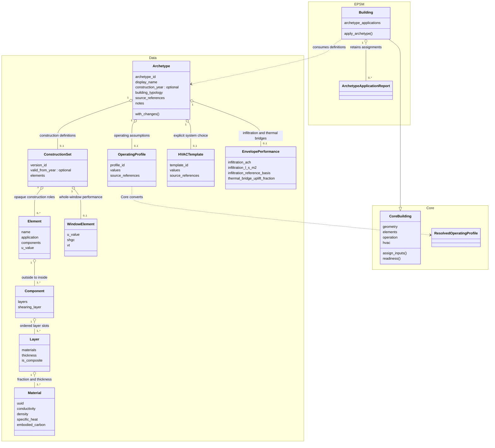

# Archetype authoring and building application

**Implemented on dev, 15 October 2026.** Catalogue selection and custom authoring
use the same physical classes and building-application route. The
[verification register](archetype-verification.md) records the merged PRs and exact
installed package combination. These development changes do not create a release.
The [harmonisation guide](harmonisation.md) describes the platform interfaces and
the [implementation series](archetype-implementation.md) records the approved scope.

## Purpose and ownership

Researchers need a predefined TABULA-inspired catalogue and a clean way to author
constructions and complete archetypes. Catalogue entries and custom archetypes
use the same classes and the same building-application operation. Selecting an
archetype remains a modelling choice, not an observation about a real building.

| Owner | Responsibility | Boundary |
| --- | --- | --- |
| Data | Construction classes, archetype definitions, operating profiles, system templates, envelope assumptions, applicability and sources | Reads packaged data only on request; has no Core or EPSM dependency |
| Core | Geometry, physical elements, installed systems, schedules, quantities, physical validation and engine compilation | Consumes portable definitions and resolved assignments; does not select catalogue archetypes |
| EPSM | Selection-to-building assembly and its assignment report | Uses public Data/Core interfaces; does not duplicate schedule or physical calculations |
| RC | Reduction and reduced-order calculation | Consumes the same resolved Core inputs; does not choose a competing programme or archetype |

Reuse the existing Sveby residential, office and school records and BEN DHW
coefficients. Data owns their definitions and supported selectors; Core retains
schedule expansion, calendar handling and physical validation. BEN normal-use DHW
is an explicit selection, not an automatic replacement of Sveby assumptions.

Missing HVAC selections, project calendars, reference areas and site conditions
remain requirements. A minimum ventilation flow does not specify an installed
topology, heating carrier or recovery system. Existing generic screening profiles
retain their assumption labels; do not substitute them for unsupported types
automatically.

## One composed archetype

This hierarchy follows Djamila's original EPSM Data class diagram and
material-to-building model. The extension preserves that composition and adds
independently reusable definitions. The diagram shows composition and package ownership. `CoreBuilding` labels
Core's existing `Building` base class; it is not a second physical model.



`Material` is the public alias for `OpaqueMaterial`. The diagram omits the small
`LayerSlot` and `LayerMaterial` values that carry order, fractions and thicknesses.
Current catalogue windows use `WindowElement` whole-window U-value and solar/visible
properties; they do not imply a newly authored multilayer glazing assembly.
Applying those properties preserves the Building's existing opening geometry.

The existing `BuildingArchetype`, publicly exposed as `Archetype`, includes
optional `operating_profile`, `hvac_template`, `envelope_performance`, source
references and notes. Catalogue and custom authoring use this same hierarchy.
`EnvelopePerformance` describes infiltration with an explicit reference basis
and thermal-bridge assumptions. Site-specific ground configuration belongs to
the Building.

Custom archetypes may have arbitrary classifications, no construction year and
incomplete sections. Constructors and `with_changes` validate supplied values
without catalogue lookup or hidden I/O. Editing a returned object does not change
its source catalogue entry.

`Catalogue.get()` and `Catalogue.for_year()` return this same archetype type.
Read-only material, construction, profile and template indexes support reuse.
Loading physical composition does not require a successful calibration check.
Existing effective properties, targets and limitations stay separately
inspectable; nominal layered U-values are not effective ground properties.
Retained identifiers containing `CALIBRATED` identify inherited recipe snapshots.
Loading or applying them does not establish a target assessment or empirical
calibration of a real building.

Complete archetype exchange uses format version 4; readers continue to accept
versions 1–3. Preserve material identities, fractions, physical order, profiles,
templates, sources and unresolved inputs without external catalogue lookup.
Summary dictionaries are not the lossless exchange route.

## Applying definitions to a Building

**Runnable with the exact development combination in the verification register:**

```python
from epsm import Building
from epsm_core import Footprint
from epsm_data import Catalogue

building = Building.from_footprint(
    Footprint.rectangle(20, 12), storeys=3, storey_height_m=2.8,
)
archetype = Catalogue.load().for_year("multi_family", 1970)
report = building.apply_archetype(archetype, mode="replace")
requirements = report.requirements
```

`epsm.Building.apply_archetype(archetype, *, mode="replace", calendar=None)`
updates the existing Building and returns `ArchetypeApplicationReport`.
EPSM maps definitions to Core inputs; Core validates and commits assignments
atomically.

| Mode | Supplied constructions | Supplied operation, HVAC and envelope sections |
| --- | --- | --- |
| `replace` | Replace covered roles; preserve uncovered roles | Replace supplied sections; preserve omitted sections |
| `fill_missing` | Assign only elements without a construction | Fill absent sections without overriding existing choices |

Preserve geometry, actual opening placement, window ratios, orientation and
context. Updating window properties must not regenerate openings. Match by
physical construction role; report unused roles as unmatched instead of creating
geometric elements.

Prepare and validate candidates before changing the Building. Invalid supplied
values leave it unchanged. Valid incomplete definitions may produce a partial
assignment, with explicit missing requirements. Do not guess Atemp, convert
source-reference ACH using an unrelated volume, or choose a project calendar to
force readiness. Weather stays an evaluation input, outside the archetype.

Operating profiles use Data's public selection functions and Core's
`resolve_operating_profile`. Office and school need explicit year, active dates
and calendar source. BEN DHW selection requires an explicit purpose; a custom
partial use overlays only supplied fields on an existing use.

Native area-based infiltration retains its declared reference basis. For Atemp,
the caller's explicit load-reference area is a recorded interpretation choice,
not a new measurement. Conflicting measured basis evidence remains unresolved.
A conditioned-floor-area policy alone does not establish Atemp. TABULA-volume
ACH is not reinterpreted as conditioned-volume ACH. Ground inputs remain on the
building. Whole-building common-space assumptions are unmatched until a supported
targeted assignment is supplied.

Reports identify applied, replaced, retained and unmatched inputs, definitions,
sources and remaining requirements. Retain the report through Building save/load
and evaluations. Earlier evaluations, source observations and renovation lineage
remain unchanged. Baseline authoring does not invent renovation material flows.

Initial scope is whole-building application. Preserve existing targeted
construction editing. New mixed-use operating-profile assignment, automatic
holiday generation, recalibration and scientific corrections are outside this
series.

## Acceptance scenarios

These extend [UC03](../use_cases/README.md#the-common-stories). The
[verification register](archetype-verification.md) maps each requirement to its
owning tests and records the completed gates and their scope.

| ID | Scenario | Observable acceptance |
| --- | --- | --- |
| AC01 | Offline authoring | Build materials through archetypes without TABULA classification, a year, Core, EPSM, database or network; inspect missing sections |
| AC02 | Catalogue customization | Catalogue and custom inputs have the same public type; editing a copy leaves catalogue and sibling objects unchanged |
| AC03 | Portable exchange | Version-4 round trips retain composition, identities, profiles and sources; versions 1–3 remain readable without lookup |
| AC04 | Geometry consumption | Assign applicable constructions and supplied profiles/templates; preserve geometry, openings and context; report unused roles |
| AC05 | Assignment modes | Replace covered inputs and retain omissions; fill-missing preserves existing per-element assignments and configured sections |
| AC06 | Invalid/incomplete inputs | Invalid supplied data leaves the Building unchanged; valid incomplete data produces requirements without invented systems, calendars or areas |
| AC07 | Physical meaning | Preserve units, Atemp/volume bases, quantities, source observations and nominal/effective distinctions |
| AC08 | Operating profiles | Preserve residential monthly totals and explicit office/school calendars in ordinary/leap years; select BEN DHW explicitly |
| AC09 | Model history | Reports survive save/load/evaluation; reapplication cannot rewrite prior evaluations or renovation history |
| AC10 | Catalogue coverage | Preserve every shipped category/configuration, source variant, SE.07 boundary, construction value and limitation |
| AC11 | Installed handoffs | Clean wheels execute custom/catalogue authoring, application, actual RC and an EnergyPlus smoke case; missing prerequisites fail required gates |

Package tests establish owned behaviour; EPSM tests real installed handoffs.
Every behaviour-changing PR includes examples, docstrings and migration notes.
The [implementation series](archetype-implementation.md) defines the order and
cleanup gate.
