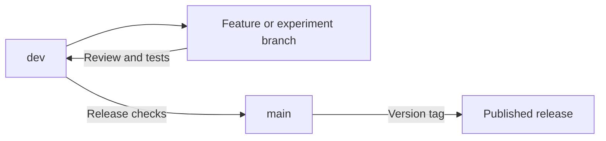

# Branches and releases

Use the same branch names and working pattern in every EPSM repository. This makes it easier to move between packages and see which version is ready to use.

## The shared branch layout

| Branch | Purpose | Where changes go next |
| --- | --- | --- |
| `main` | The stable release line: reviewed code, working examples and stated limitations | Each published release gets a version tag |
| `dev` | The shared development version, where new work comes together | A tested release goes to `main` |
| `feature/<short-name>` | One feature, fix or documentation change, started from `dev` | A pull request back to `dev` |
| `experiment/<short-name>` | A trial idea or method, started from `dev` | Tested work may go to `dev`; unfinished work stays on the branch |

Coding agents use `codex/<short-name>` for ordinary work, or `codex/experiment/<short-name>` for experiments. These branches follow the same rules as human-created feature and experiment branches.

`dev` is the home of development. Start work from its current version and bring completed changes back there. Keep `dev` usable: code merged into it should pass the development checks. Experiments need their own branch while their behaviour or method is unsettled.



Here, stable means a tested release with a clear scope and known limitations. It does not mean that every building type or scientific method has been validated. A stable handbook can describe a proposed API as long as that status is clear.

## Start a change

First check your branch and local changes with `git status`. Keep any existing work safe. Do not reset, clean away, overwrite or silently stash another person's changes to make the commands fit.

For a repository with a configured remote and an existing `dev` branch:

```sh
git switch dev
git pull --ff-only origin dev
git switch -c feature/read-weather
```

Use `experiment/future-weather` for a trial method, or `codex/read-weather` when an agent is doing the work. Pick a name that describes one task.

Write the tests, make the change, update the documentation and examples, then open a pull request with **`dev` as its target**. A pull request is a proposed change that others can review before it is merged.

Do not send an ordinary feature or experiment straight to `main`. If an experiment is ready to become a supported feature, state what is supported, add its tests and examples, and merge that work into `dev`. Merging an experiment does not establish scientific accuracy.

## Prepare a release

1. Choose the tested set of changes on `dev`. Finish its version information, release notes and any migration instructions.
2. Run the release checks: package tests, installation checks, advertised examples and required package integrations. Run notebooks from a fresh kernel. A missing required check does not count as passing.
3. Open a release pull request from `dev` to `main`. Review the change and check the final merge result.
4. Merge the release using a normal merge that preserves the shared history. Do not squash or rebase this release merge.
5. Tag the resulting `main` commit as `vX.Y.Z`, using that package's actual version, then publish from that tag.
6. Bring `main` back into `dev` so the next development cycle includes the released history.

Feature pull requests may be squashed into `dev` when that makes their history clearer. Release merges keep the shared history so later releases and fixes can be merged cleanly.

If development must continue while a release is being checked, start a temporary `release/X.Y.Z` branch from the chosen `dev` commit. Put only release fixes there. Merge it into `main` after the checks, tag the released commit, then merge the released history back into `dev`.

Each package can have its own version and release date. Before an EPSM release, record which package versions passed the shared use cases. Research studies pin those versions or exact commits; they do not follow a moving branch name.

Never move or reuse a published release tag. A correction needs a new version.

## Fix an urgent problem in a released version

For a small urgent release fix, start `hotfix/<short-name>` from `main`. Keep the fix narrow, test it and use a reviewed release pull request to merge it into `main`. Tag the new patch release, then merge `main` back into `dev`.

This is the exception to starting ordinary work from `dev`. It lets a released version receive a fix without taking unfinished features from development.

## Set up a new repository

Start `main` with a checked baseline. Create `dev` from it once:

```sh
git switch main
git switch -c dev
```

If the repository has a remote, publish both branches and set `dev` to track its remote counterpart:

```sh
git push -u origin main
git push -u origin dev
```

Keep both branches. Use `main` as the repository's default branch and direct development pull requests to `dev`. The [branch-policy template](templates/branch-policy.md.tmpl) can be copied into each repository's contribution guide or README.

## Protect the shared branches

On the repository host, protect `main` and `dev`. Require pull requests, the agreed checks and a maintainer review. Block force pushes and deletion of these branches. Allow normal merge commits so the release path described above remains possible.

Development checks run on feature branches and pull requests into `dev`. Release checks cover pull requests into `main` and the final tagged release. Fix a failing check before promoting the change.

These are settings to apply when each repository adopts the policy. Adding this page does not configure branch protection or change other repositories.

For the underlying Git commands, see [Git's branching guide](https://git-scm.com/book/en/v2/Git-Branching-Branching-Workflows). For hosted protection settings, see [GitHub's protected-branch guide](https://docs.github.com/en/repositories/configuring-branches-and-merges-in-your-repository/managing-protected-branches/about-protected-branches).
