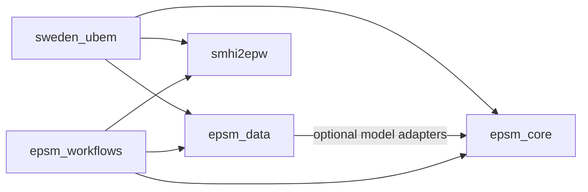

# EPSM harmonisation review

**Inspection date: 14 October 2026. Status: current implementation inventory and proposed changes.**

This review supports a discussion with the platform maintainer before package transfers and public API changes. The user requested a staged harmonisation: consistent names, preserved and synchronized Git history under SB-Chalmers, agreed package responsibilities, common data models, friendly APIs, updated documentation, and verified tests and examples.

The [engineering guide](engineering-style.md), [model agreements](terminology-and-models.md), [branch policy](branches-and-releases.md), and [roadmap](roadmap.md) supply the starting direction. The decisions below remain open unless their status says otherwise. No runtime package has been refactored by this review.

The [file map](harmonisation-file-map.md) marks concrete candidates for discussion. The [static inventory](harmonisation-inventory.json) records local revisions, working changes, source file hashes, public definitions, platform imports, and supporting test/example paths. Hashes identify inspected files; they are not a backup of file contents. The inventory is a sequential reading of active checkouts, so reconfirm changed files before implementation.

## Work sequence

| Stage | Deliverable | Completion condition |
| --- | --- | --- |
| 1. Understand the current platform | Current package descriptions, dependency map, Git inventory, and file dispositions | Existing code and research additions are represented; unknowns are explicit |
| 2. Agree names and preserve development | Repository/distribution/import/command name table; preserved local work; SB-Chalmers remotes; main/dev policy | Naming decisions are recorded and every intended source change is recoverable and accounted for remotely |
| 3. Agree responsibilities and required features | Discuss the file map package by package and record decisions | Every transfer has an owner, a consumer, and behavior to preserve |
| 4. Agree common models and ownership | Concrete record, stock, assignment, building, weather, comparison, study, and result examples | Fields, units, missing-data rules, identity, serialization, and ownership are agreed |
| 5. Implement one complete route | Retrieve stock, inspect evidence, apply assumptions, create a Building, and compare properties | Tests use installed collaborating packages and preserve the selected baseline behavior |
| 6. Refactor in small changes | Transfers, public APIs, migrations, documentation, tests, and examples together | Each change passes its owner checks and affected integration examples before merging to dev |
| 7. Release a compatible package set | Recorded versions, release notes, installation and real service/engine evidence | Advertised routes work from installed packages; unrun required checks remain unverified |

Naming work includes local directories, hosted repositories, Python distributions, imports, commands, metadata, documentation URLs, CI, and existing consumers. A repository rename alone does not finish the naming stage. Preserve physical assumptions and numerical results during structural changes; review a scientific change separately.

## Names and Git state

These facts were checked locally and through the authenticated GitHub API on 14 October, before the naming changes requested later in the discussion. GitHub branch tips matched the locally recorded upstream tips for the repositories below. Visibility here is observed state, not a proposal to change it. The static inventory retains these original names and revisions.

| Current checkout / distribution / import | Proposed identity | Observed Git situation | Required preparation |
| --- | --- | --- | --- |
| `EPSM-Development` / handbook | `epsm_development` | SB-Chalmers; private; main and dev both at `35299f83ffb6`; clean before this review | Rename repository; save this review on `codex/harmonisation-map`, then review into dev |
| `EPSM_data` / `epsm_data` / `epsm_data` | Keep `epsm_data`; normalize repository case | SB-Chalmers; private; clean `dev_sanjay` at `c0c5c4476bc5`, two local commits ahead; `DEV` also exists and diverges from its upstream | Preserve both development lines; reconcile their histories before choosing lowercase dev; retain baseline tags and dataset identities |
| `epsm_core` / `epsm_core` / `epsm_core` | Keep `epsm_core` | SB-Chalmers; private; main at `c832663cf774`, six local commits ahead; additional untracked multifamily layout experiments/tests/scripts | Review and preserve those additions, then establish dev without presenting unreviewed work as a release |
| `epsm_workflows` / `epsm_workflows` / `epsm_workflows` | Keep `epsm_workflows` | Origin points to `snjsomnath/epsm_workflows`; main at `60499fee8b89`, ten local commits ahead; modified metadata/README and 61 untracked source modules | Preserve source, tests, examples and research inputs deliberately; establish the SB-Chalmers repository and dev history |
| `sweden_building_combined` / `sweden-ubem` / `sweden_ubem` | `epsm_db` | Local Git now exists, main at `1f67388eb62c`; no remote; modified source and new stock/remote-pipeline work | Preserve current changes; establish an SB-Chalmers repository; separate code from excluded source assets and running database state |
| `smhi2epw` / `smhi2epw` / `smhi2epw` | Keep `smhi2epw` | SB-Chalmers; public; main at `434d7b26de1a` matches remote; clean | Add dev and align the development checks with the shared branch policy while retaining release gates |
| Empty local `epsm` directory | New Python `epsm` interface | No local Git; **SB-Chalmers/epsm is already occupied by the web application** | Resolve the repository-name conflict before creating a new umbrella project |
| Empty local `epsm_studies` directory | `epsm_studies` | No local Git or matching repository in the queried organization listing | Establish it when the first study transfer has a defined scope |
| `epsm_studio` web application | Confirmed `epsm_studio` | Local origin still says `snjsomnath/epsm`; development at `e6d7f0f43bd7`, with two modified files; SB-Chalmers/epsm contains the React/Django app | Rename the hosted repository as requested; decide application integration scope separately |

Existing commands include `epsm-core`, `epsm-workflows`, several study-specific `epsm-*` commands, `epsm-matrix-audit`, `sweden-ubem`, and `smhi2epw`. Decide their supported replacements alongside imports and documentation. The inspected SB-Chalmers main/dev branches were not marked protected by GitHub; the handbook's protection policy has not yet been applied there.

The 13 October ecosystem review remains a dated record. In particular, its statement that the database lacked Git is historical: this inspection found a local repository. The new stock implementation is also newer than that earlier review.

### Naming changes completed during this review

The user confirmed the short package names `epsm_data` and `epsm_db`, requested `epsm_development` for the handbook, and explicitly requested renaming the remote web application to `epsm_studio`.

| Hosted repository | Completed action |
| --- | --- |
| [SB-Chalmers/epsm_development](https://github.com/SB-Chalmers/epsm_development) | Renamed from EPSM-Development; updated the local origin URL; main/dev revisions and private visibility retained |
| [SB-Chalmers/epsm_data](https://github.com/SB-Chalmers/epsm_data) | Normalized repository spelling from EPSM_data; updated the local origin URL; branches and private visibility retained |
| [SB-Chalmers/epsm_studio](https://github.com/SB-Chalmers/epsm_studio) | Renamed from epsm; updated the local epsm_studio origin URL from the former personal URL; existing branches and public visibility retained |

Repository metadata and branch revisions were verified after the renames. The existing handbook and Data checkout directories still use their original local names during the active review. Database distribution/import changes, repository setup for Database/Studies, and preservation/synchronization of outstanding research work are still pending. Moving the web application frees the intended hosted name; a new Python epsm repository has not yet been created.

## What each package currently does

### Database: sweden_ubem

This package ingests and links Swedish building, footprint, property, address, height, EPC and context evidence into PostGIS. It processes selections, reports quality/completeness, retains original-source references, and exposes records and dataframe views. Existing public routes include `UBEM`, `Building`, `fetch_record`, `fetch_records`, `BuildingRecord`, and `RecordCollection`.

The new, untracked `stock.py` already provides `Stock`, `StockCell`, catalogue-backed matrices, lazy record iteration, plots, and bulk model creation. This is concrete starting material for the interface discussed with the user. Its constructor loads epsm_data, and catalogue classification is spread across stock and exploration methods.

The package also contains `EPSMBuilding`, `ModelPolicy`, a `WeatherReference`, geometry/operating/system defaults, model assembly and simulation. `epc_heating.py` combines source target interpretation with simulation-period comparison. These responsibilities need splitting. `comparison.py`, however, compares evidence relations against an oracle and belongs with database validation.

`BuildingRecord` retains a private database URL and can query neighbours or create EPSM models. Its `Receipt` combines source completeness with model readiness. These are specific model-boundary questions for the redesign. The reader still queries internal `catalog` metadata; access using the intended restricted login needs explicit verification.

### Data: epsm_data

Data holds frozen archetype/construction resources, material layers, nominal/reference properties, source evidence, renovation definitions, and cohort artifacts. Current APIs include `ParametricCatalogue`, `DetailedCatalogue`, `CalibratedArchetype`, and older domain objects such as `BuildingArchetype` and `ConstructionSet`.

It also performs thermal reference calculations, exports to Core and Honeybee, resolves building-specific component assignments, applies effective cohort profiles to Core models, and supplies section plots and an explorer. The basic install has no third-party runtime dependency; several integrations use lazy optional imports.

The proposed Catalogue needs one understandable way to inspect definitions and compose assumptions. Preserve DB 1.5.0 / LoD2 v1.4 values, source identities, checksums and validation qualifications while consolidating representations. Thermal reference evaluators require a separate ownership decision because catalogue inspection currently works without Core.

### Core: epsm_core

Core owns typed physical specifications, footprint preparation, zoning, roofs, facades, context/shading, thermal construction behavior, quantities, physical renovation operations, EnergyPlus compilation/execution, delivery/PV calculations, diagnostics and result interpretation. It also supports previews and a notebook course.

Core currently bundles Sveby residential/office/school and BEN DHW profiles, generic-use assumptions, and `BuildingBuilder` selection/merge behavior. Profile values belong in the assumption inventory; physical schedule evaluation, validation and engine mapping need to retain clear owners when those profiles move.

The existing `BuildingSpec` is immutable and validates a simulation-oriented model. A researcher-facing Building must support incomplete authoring while preserving one physical implementation. The design should decide how that authoring object freezes into the validated execution input before introducing additional classes.

### Workflows: epsm_workflows

Workflows contains restartable local/Slurm campaign execution, `CampaignCase`, preflight, persistent DuckDB shards and collection. It also contains evidence ingestion, fabric construction, weather coordination, EPC comparisons, named calibration/diagnosis/stock studies, surrogate design and many research scripts.

The main CLI currently validates the specific Vera study's seed, site count and Core revision. Campaign weather storage assumes 8,760 rows and relabels the calendar as 2018. Extracting reusable execution must preserve the historical campaign's reproducibility while allowing new studies to declare their own calendars and input identities.

Of 75 source modules in this checkout, 61 are untracked. Named study code and tests must be preserved before transfers; a clean remote clone does not describe the implementation currently being used.

### Weather: smhi2epw

The weather package provides provider acquisition, gap recovery, solar processing, EPW generation/reading and provenance through `EPWConfig`, `compile_epw` and `read_epw`. It has no imports from the other EPSM packages in the static source inventory.

Its existing CI covers multiple Python versions, minimum dependencies, installed wheels, documentation, deterministic EnergyPlus integration and separately scheduled live-provider tests. Keep those capabilities and its independent public interface. The platform still needs one agreed weather artifact/reference and consistent calendar handoffs; current database and workflow wrappers duplicate that integration.

### EPSM, Studies and the web application

The local Python umbrella and Studies directories are empty. Existing database assembly, stock exploration and study code provide candidates for their initial implementations. Introduce them around accepted workflows rather than new placeholder frameworks.

The existing hosted EPSM application is a separate React/TypeScript frontend and Django/Celery backend with component data, uploaded-IDF workflows, scenario management and batch simulation. This review inspected its repository metadata and README only; its backend/frontend implementation has not been audited. Its integration and retirement/preservation policy require a scope decision before moving its code.

## Present dependency directions

This diagram describes observed imports and optional integration paths, including responsibilities proposed for transfer. It is not the target architecture.

Core has no dependency on the other platform packages in the source import inventory, but it owns several catalogue definitions internally. Import direction alone therefore does not demonstrate correct responsibility boundaries.

## Decisions to discuss

Ask these in small groups and record the user's actual choices. Recommendations are proposals, not accepted decisions.

| ID | Question | Starting recommendation | Status |
| --- | --- | --- | --- |
| D01 | Which names should be canonical? | User confirmed epsm, epsm_db, epsm_data, epsm_core, epsm_workflows, epsm_studies, smhi2epw and epsm_development; keep Data's name and use the short Database name | Accepted, 14 October 2026 |
| D02 | How should the existing SB-Chalmers/epsm web application be named and scoped? | User explicitly requested renaming the remote to epsm_studio; application integration scope is a later discussion | Name accepted, 14 October 2026 |
| D03 | Should a stock remain usable with only the database library installed? | Database owns records, queries and evidence completeness; EPSM composes an enriched stock with catalogue assignments and model creation | Asked; awaiting answer |
| D04 | Which assumptions should be reusable catalogue definitions, and which should remain study choices? | Catalogue owns sourced reusable fabric, operation, systems and completion profiles; studies retain their experimental overrides and selection protocols | Asked; awaiting answer |
| D05 | Where should the physical Building and its authoring behavior live? | Core owns physical state and validation; EPSM exposes convenient creation, evidence mapping and scenario operations | Open |
| D06 | What compatibility must the migration preserve? | Preserve data, numerical behavior and historical reproducibility; explicitly agree import/command aliases versus a documented API migration before renaming | Open |
| D07 | What makes an execution function reusable rather than study-specific? | Workflows accepts prepared cases and retains all attempts; Studies selects cases, assumptions, calibration methods and research comparisons | Open |
| D08 | Which first user workflows define acceptance? | Database completeness; stock/archetype inspection; one record to an incomplete Building; evidence-to-model comparison; one simulation; one independent renovation scenario | Open |
| D09 | Where do catalogue thermal calculations and physical representations belong? | Compare existing algorithms and consumers before choosing a shared implementation; preserve independent catalogue inspection | Open |

Implement the accepted names and preserve development before synchronization. Next discuss D03/D04 using the database and catalogue file rows, then physical models, execution, and the remaining packages. Do not infer decisions from the absence of a reply.

## Required features to confirm

| Proposed owner | Minimum user capabilities for discussion |
| --- | --- |
| Database | Open a pinned evidence release; inspect coverage and field completeness; query/stream records; retain source scope and conflicts; export portable evidence; maintain separately validated releases |
| Catalogue | Browse archetypes and all reusable assumption profiles; inspect applicability, units and sources; compose profiles; compare versions; describe measures and factors; remain usable without a simulator |
| EPSM | Obtain and filter stock; track archetype assignments; create models from records or footprints; inspect assumptions and readiness; override choices; compare evidence/model properties; create independent scenarios; open retained results |
| Core | Physical objects and geometry; calculations and quantities; validate complete execution inputs; compile/run a single case; interpret results; preserve diagnostics and engine identity; inspect geometry before simulation |
| Workflows | Execute prepared cases locally/on clusters; retain attempts and failures; resume safely; collect/aggregate results; expose progress; keep study artifacts attributable to fixed inputs |
| Studies | Organize named studies, configurations, cohort selection, calibration, analyses and reports; reproduce historical results using pinned collaborators |
| Weather | Generate and inspect EPWs; explain recovery/provenance; preserve calendar and weather identities; remain independently usable |
| Web application | Role and supported user flows still to be discussed after D02 |

## Model questions after responsibilities are agreed

The first model review should use one incomplete record, one fully evidenced record, a shared-certificate example, and a building created from a footprint. Trace each through stock selection, archetype assignment, assumption resolution, model authoring, simulation and comparison.

Agree the owner and serialized meaning of BuildingRecord, Observation, evidence release, BuildingStock, ArchetypeAssignment, assumption definition, resolved assumption set, physical Building, WeatherReference, Comparison, Scenario, Study, Run, Attempt and Result. This list is a discussion vocabulary, not an instruction to create one class per term.

In particular, distinguish source completeness from model readiness; preserve observed and assumed values together; identify catalogue assignments with rules and versions; keep live database access off portable records; retain certificate scope; and freeze model/input identities before execution. Units, area bases, calendars and energy boundaries need explicit comparison rules.

## Behavior preservation and checks

The file map associates affected code with existing tests and examples. Before each transfer, run the relevant existing tests and retain their results with the package versions and prerequisites. Add observable characterization cases where the intended behavior is not covered. Then run the same cases against the new owner and the affected installed-package integration.

Installation checks must verify declared optional dependencies and packaged JSON, SQL, configuration and viewer assets outside sibling editable checkouts. Public examples should run in fresh processes or notebook kernels. Where historical runs need the old interface, preserve their pinned environment or an explicitly agreed compatibility route.

At this stage only static source/API, metadata, documentation and Git inspection has been performed for runtime packages. No package test suite, database query, source import, EnergyPlus simulation or provider request was executed. Existing CI definitions describe intended checks, not evidence that those checks passed during this review. The web application's implementation remains outside the completed source inspection.

For the handbook changes, `python3 scripts/check_docs.py`, `python3 -m unittest discover -s tests -v`, and `python3 scripts/run_examples.py` passed. This covers local links, example syntax, template doctests, 11 checker/runner tests and the two executable teaching notebooks. It does not validate runtime package integrations.
